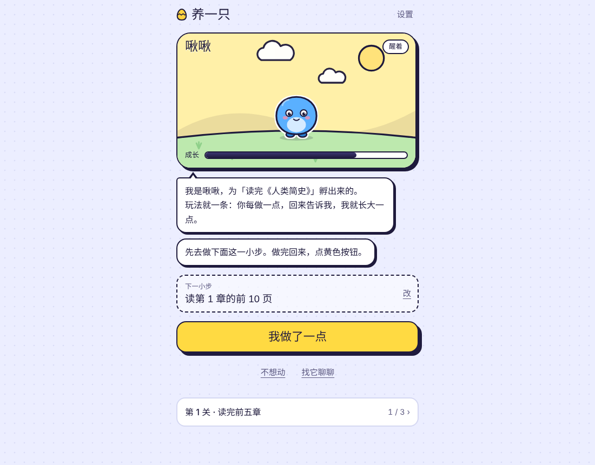
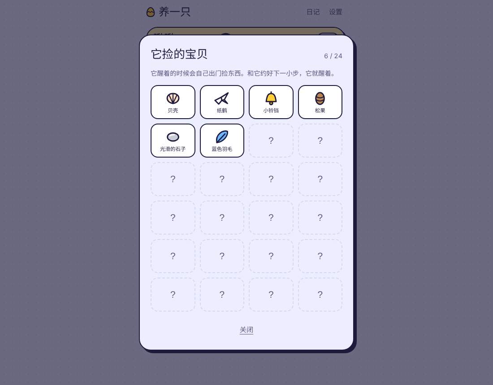

# 养一只

为一个长期目标孵一只 AI 伙伴的网页应用原型。解决的问题：目标做到一半容易中断、放弃，缺少把人拉回来的钩子。思路是不防中断，而是让「回来」变便宜、有奖励；只奖励真实行动，不惩罚中断。

界面中文。零依赖、无构建框架，运行时是单个 HTML 文件。

| 主界面 | 路线 | 宝贝 | 蜕变 |
|---|---|---|---|
|  |  |  |  |

## 运行

直接打开 `dist/index.html` 即可（已构建好）。修改源码后重新构建：

```
python3 src/build.py     # 把 src/ 下的 CSS/JS 内联进 dist/index.html
```

## 目录

```
src/
  pet.js        规则引擎（纯函数，时间由外部传入）
  critter.js    伙伴形象、场景、24 种宝贝图标（SVG）
  sfx.js        WebAudio 合成音效
  fx.js         canvas 粒子
  strings.js    中文文案和模型提示词（按语言分表）
  llm.js        外部大模型接入（OpenAI 兼容 / Anthropic 协议）
  config.json   随包配置（功能开关、官方模型、上报地址、限额、远程配置地址）
  agent/        Agent 基建：运行时、记忆、提醒、红线、平台适配、追踪（见 docs/agent-runtime.md）
  app.js        界面与流程；Store / AI 两个适配器
  style.css     样式
  shell.html    页面外壳
  build.py      构建脚本
  sim.js        规则模拟：7 种节奏 × 60 天（node src/sim.js）
proxy/
  worker.js     模型网关（藏密钥、补跨域头、限来源和模型、按设备每日额度、备用模型），部署说明见 proxy/README.md
evals/
  redline.mjs   红线评测：27 条用例，用真实模型跑
tests/
  e2e.py        Playwright 端到端（带 window.claude 替身）
  e2e_llm.py    外部大模型接入的端到端测试
  e2e_agent.py  Agent 基建端到端（记忆、提醒、红线重试、危机、计时、日历、反馈、导入删除、远程配置）
  mock_llm.py   假的 OpenAI 兼容 / Anthropic 接口
  art.html      形象预览页
docs/
  design-notes.md       设计记录（规则、红线、各版演进、已知缺口、剩余任务）
  agent-infra.md        作为陪伴型 Agent 需要的基建：调研与路线图
  dev-plan.md           基建开发计划和当前进度
  agent-runtime.md      Agent 运行时说明（模块、存档字段、远程配置、怎么加提示词）
  legal/privacy-draft.md  隐私政策草稿（待专业人士审阅）
  liaoyuan-v1-notes.md  前身《燎原》（森林题材）的设计记录
```

## 大模型

它说的话可以来自三处，按优先级：

1. **你自己接的大模型**：设置 → 它的脑子 → 接入大模型（第一次孵化前，第一页底下也有入口）。预设了 DeepSeek、通义千问、Kimi、智谱、OpenRouter、Claude API、OpenAI，也可以填任何 OpenAI 兼容接口或自建代理。密钥只存在本机浏览器里，不进存档。
2. **claude.ai 宿主里的 Claude**：页面作为 claude.ai artifact 打开时，通过 `window.claude` 调用，并把存档存到 Claude 账号。
3. **预先写好的台词**：都没有时使用，聊天入口隐藏。

不少服务商（DeepSeek、OpenAI 等）不允许网页直接调用，测试会提示「连不上」。这时部署 `proxy/` 里的代理，再选「自建代理」。Claude API 和 OpenRouter 可以直连。

存档：在 claude.ai 之外，进度存在浏览器 localStorage（键 `yangyizhi.save.v2`）。

## 测试

```
pip install playwright && playwright install chromium
cd tests && mkdir -p shots
python3 e2e.py              # 带模型替身
python3 e2e.py --nomock     # 无模型
python3 e2e.py --reduce     # 减少动效
python3 mock_llm.py 8765 & python3 mock_llm.py 8766 --nocors &
python3 e2e_llm.py          # 外部大模型接入
python3 e2e_agent.py        # Agent 基建
node ../src/agent/rhythm-sim.js   # 提醒节奏模拟
node ../src/sim.js          # 规则模拟
```

## 多端构建、更新与腾讯云发布

项目保持原生 JavaScript + Python 构建。Web、Windows/macOS 桌面包与 Android 包使用独立客户端版本，来源见 `clients/versions.json`。构建与更新方案、签名要求、腾讯云隔离部署和回滚流程见 [多端更新说明](clients/UPDATES.md)、[更新清单协议](updates/README.md) 和 [腾讯云部署说明](deploy/README.md)。

云同步服务采用独立的 Node.js 服务和版本化 JSON 工作区，保存每个账号的养一只完整存档；与拾光类似，账号、每设备登录会话、数据修订号分开管理。数据文件、systemd 服务、端口、URL 路径和备份目录均使用 `yangyizhi` 专属名称，不共享拾光数据。Web 静态资源与账号 API 由同一 HTTPS 来源提供；GitHub Pages 保留用于静态预览，账号云同步以腾讯云产品入口为准。

## 四条红线

写进了每次调用模型的人设提示词：它不受苦；它不黏人；它说实话；它不占时间。详见 `docs/design-notes.md`。

## 已知缺口

账号与云同步服务端、前端适配和加密备份脚本已进入实现，产品入口已确定为现有腾讯云主机的 `/yangyizhi/` 独立路径；线上仍需完成一次服务器初始化和健康验收（本机尚无可用 SSH 登录）。提醒只在安卓 App 里有，真机未验证；真实模型的对话质量还没有评测基线；声音手感、低端手机性能未验证；没有付费、多只同时养。进度见 `docs/dev-plan.md`。
