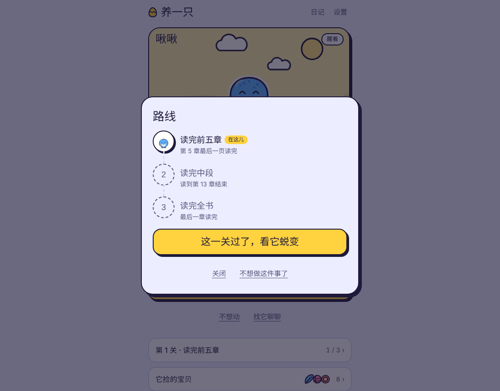
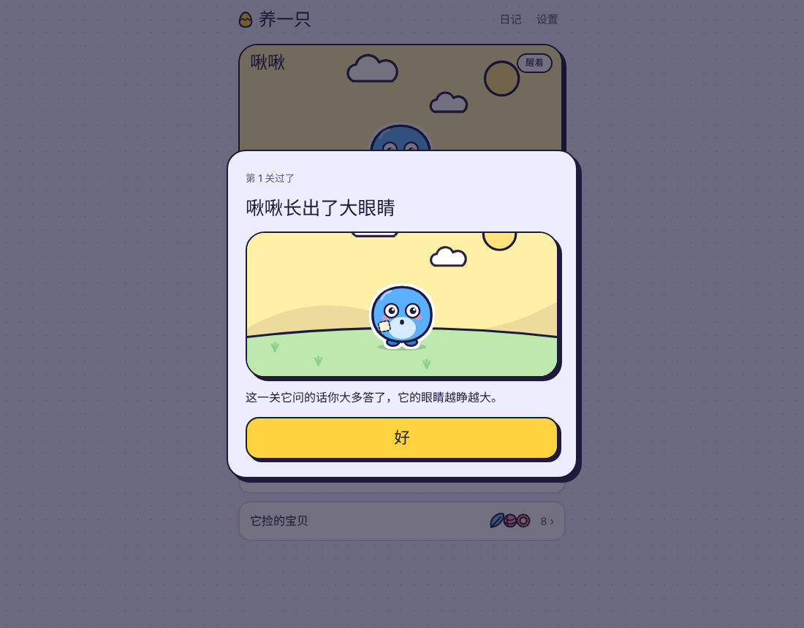

# 养一只

为一个长期目标孵一只 AI 伙伴的网页应用原型。解决的问题：目标做到一半容易中断、放弃，缺少把人拉回来的钩子。思路是不防中断，而是让「回来」变便宜、有奖励；只奖励真实行动，不惩罚中断。

界面中文。零依赖、无构建框架，运行时是单个 HTML 文件。

| 主界面 | 路线 | 宝贝 | 蜕变 |
|---|---|---|---|
|  |  |  |  |

## 运行

直接打开 `dist/index.html` 即可（已构建好）。修改源码后重新构建：

```
python3 src/build.py     # 把 src/ 下的 CSS/JS 内联进 dist/index.html
```

## 目录

```
src/
  pet.js        规则引擎（纯函数，时间由外部传入）
  critter.js    伙伴形象、场景、24 种宝贝图标（SVG）
  sfx.js        WebAudio 合成音效
  fx.js         canvas 粒子
  strings.js    中文文案和模型提示词（按语言分表）
  app.js        界面与流程；Store / AI 两个适配器
  style.css     样式
  shell.html    页面外壳
  build.py      构建脚本
  sim.js        规则模拟：7 种节奏 × 60 天（node src/sim.js）
tests/
  e2e.py        Playwright 端到端（带 window.claude 替身）
  art.html      形象预览页
docs/
  design-notes.md       设计记录（规则、红线、三版演进、已知缺口）
  liaoyuan-v1-notes.md  前身《燎原》（森林题材）的设计记录
```

## 依赖于 Claude artifact 环境的部分

原型发布在 claude.ai 的 artifact 里，用到三个宿主能力：

- `window.claude`：调用模型（`claude.use("sample")`）
- 云端存档：`db`，路径 `data/users/<uid>/pet`
- 用户身份：`user`

在 claude.ai 之外运行时，这些都不存在：存档自动退回浏览器 localStorage（键 `yangyizhi.save.v2`），AI 功能关闭并改用预先写好的台词，聊天入口隐藏。要接别的模型，只需改 `app.js` 里的 `AI` 适配器。

## 测试

```
pip install playwright && playwright install chromium
cd tests && mkdir -p shots
python3 e2e.py              # 带模型替身
python3 e2e.py --nomock     # 无模型
python3 e2e.py --reduce     # 减少动效
node ../src/sim.js          # 规则模拟
```

## 四条红线

写进了每次调用模型的人设提示词：它不受苦；它不黏人；它说实话；它不占时间。详见 `docs/design-notes.md`。

## 已知缺口

没有推送；长期记忆只是最近几条日记原样发给模型；真实 Claude 对话质量、声音手感、低端手机性能都未验证；没有账号、付费、多只同时养。
